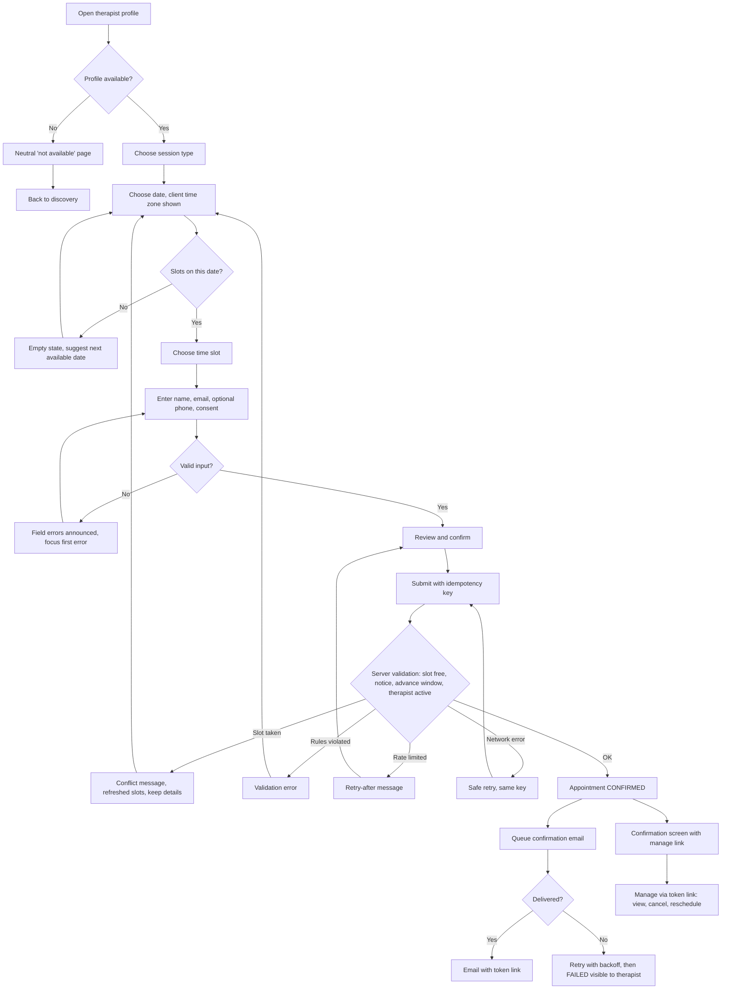
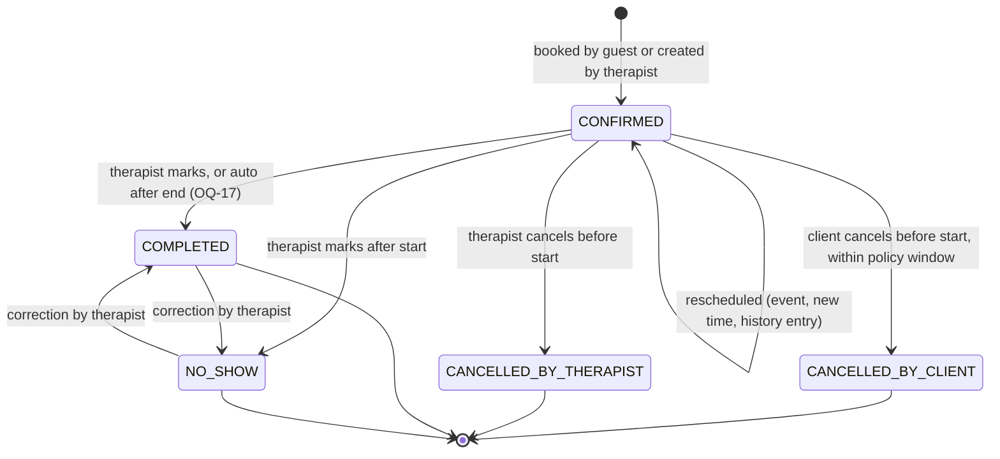

# User Journeys

Companion to `docs/product-requirements.md` (REQ/BR/EC/AC IDs refer to it). Journeys are product-level; screens and technical behaviour are decided elsewhere. Every screen has loading, empty and error states (REQ-NFR-004).

## 1. Guest (client) journeys

### 1.1 Discover a therapist
1. Guest lands on the home page and chooses "Find a therapist" (or arrives from a shared profile link).
2. Discovery shows paginated cards. Guest searches by text and filters by specialization, location, language, online/in-person. Filters are in the URL.
3. Guest opens a profile: photo, bio, specializations, languages, location, session types and durations, availability preview, credentials disclaimer.
Error and edge paths
- No results: empty state with "clear filters".
- Page beyond last: redirect to last page.
- Unpublished/disabled/unknown slug: neutral "this page is not available" with a link to discovery.
- Demo therapist: "Demo content" label visible.

### 1.2 Book an appointment (primary flow)
1. Open profile, press "Book a session".
2. Choose session type (name, duration, online/in-person).
3. Choose date. The calendar shows the therapist's dates, and disables days without availability; time zone shown with a switcher (default: browser zone).
4. See available slots for that date in the client's zone, with the therapist's local time shown alongside.
5. Choose a time.
6. Enter name, email, optional phone, tick the consent box. No reason-for-visit or health question appears, with a short line explaining why.
7. Review summary (therapist, type, date/time in both zones, cancellation policy) and confirm.
8. Confirmation screen with details and manage link; confirmation email arrives.
Error and edge paths
- Slot no longer available at step 7 (EC-12, EC-19): message, refreshed slot list, entered details kept.
- Validation errors: field-level, announced to assistive tech, focus moves to first error.
- Double click or reload on confirm: idempotent, same appointment (EC-15).
- Client zone differs and the date changes across zones: slot shows both local dates (BR-TIME-006).
- Zero slots for the chosen date: empty state with the next available date; zero slots overall: guidance and no booking CTA (BR-SLOT-004).
- Session timeout or network failure on submit: retry safely using the same idempotency key; error message with retry.
- Rate limited: message with retry time.
- Therapist disabled/unpublished mid-flow: clear message, nothing is booked.
- Email delivery failure: booking still confirmed; screen shows details (REQ-NOTIF-005).
- Per-email booking limit reached (OQ-09): message to manage or cancel an existing booking.

### 1.3 View and cancel via secure link
1. Open the link in the confirmation or reminder email.
2. See appointment details in own zone (and therapist's zone), status, policy and deadline.
3. Choose "Cancel appointment", see an explicit confirmation step (never cancel on page load), confirm.
4. Cancelled state shown; cancellation email sent to both parties.
Error and edge paths
- Invalid, malformed or expired link: neutral "link not valid" page, option to contact the therapist is not shown (avoids oracle); a generic "resend my link" form (S).
- Inside the late window: no cancel button, policy explanation and therapist contact shown.
- Already cancelled: shows cancelled state; repeating is harmless.
- Appointment already started or past: view only.
- Account disabled/deleted: notice page (OQ-16).
- Email preview bot opens link: no state change (EC-26).

### 1.4 Reschedule via secure link
1. Open the link, press "Change time" (offered only if the policy allows).
2. Pick a new date/slot (same session type) using the booking components.
3. Review old vs. new time, confirm.
4. Updated confirmation; reschedule email is sent; reminders re-planned.
Error and edge paths
- New slot taken concurrently: conflict message, the original appointment untouched (AC-RESCH-2).
- Policy window passed: action unavailable with explanation.
- Same time selected: rejected with a message.
- No other availability: empty state, option to cancel instead (if policy allows) or contact therapist.

### 1.5 Receive reminder
Reminder email (default 24h before) with date/time in the client's zone, manage link. If cancelled/rescheduled before, the reminder is skipped or reissued with new time (EC-58). If booked inside the lead time, none is sent (EC-60).

### 1.6 Privacy requests (guest)
Guest uses the contact route in the privacy policy to ask the therapist/platform for access or deletion. Product-level: handled by the therapist's client deletion/export or the platform contact (REQ-PRIV-005/006).

## 2. Therapist journeys

### 2.1 Register and onboard
1. Registration: email, password, time zone (detected), accept Terms and Privacy.
2. Email verification (S).
3. Dashboard shows onboarding checklist: profile, session types, working hours, cancellation policy, publish.
4. Publish: validation requires at least one active session type, working hours, and a name; the booking link is shown to copy.
Error and edge paths
- Email already registered: generic message (S, with verification).
- Weak password: inline message with requirements.
- Rate-limited registration.
- Publishing blocked with a checklist of missing items.
- Slug conflict or reserved slug: inline suggestion.

### 2.2 Log in and manage account
- Login with generic errors; throttling after repeated failures; disabled-account message; password reset (S).
- Settings: change password (current required), notification preferences, time zone (with future-appointment warning, OQ-07), cancellation policy, export data, delete account (re-authentication, clear explanation that future appointments are cancelled and clients notified).
- Session expiry: redirected to login and back to the previous page.

### 2.3 Set up availability
1. Open Availability. Set weekly hours per weekday (multiple ranges per day), breaks, session durations, buffer, minimum notice, max advance, slot grid.
2. Add date blocks (full day, time range, range of dates, private label).
3. Preview as client.
4. Save. If the change conflicts with future confirmed appointments, a list is shown requiring acknowledgement; nothing is auto-cancelled.
Error and edge paths
- Overlapping ranges, end before start, break outside hours: inline validation.
- Duration longer than all ranges: warning, no slots.
- DST transition days: preview shows correct reduced/extended hours (EC-1, EC-2).
- Time zone change: warning with affected count.

### 2.4 Manage appointments
1. Appointments list: search, filter, sort, paginate.
2. Open details: client contact, times, status, history, email delivery status.
3. Actions: cancel (optional message), reschedule (date/time picker, optional override of availability rules, never overlap), mark completed/no-show after start.
4. Create appointment: choose client (existing or new), session type, time; validation identical to public booking (override optional); optional confirmation email.
Error and edge paths
- Overlap or concurrent change: conflict message with refreshed data.
- Email failed: visible badge, "retry" is out of scope (automatic retries only), shows client's contact.
- Past-dated creation: allowed as completed record (OQ-20), no email.
- Another therapist's id in the URL: not found.

### 2.5 Manage clients
List with search/filter, detail (contact, history, upcoming), edit contact info, book on behalf, delete/anonymize (confirmation explains future appointments will be cancelled and notified). No notes field.

### 2.6 Use the calendar
Day/week/month views, navigation, today, jump to date; click event for details and actions; click empty slot to create. Narrow screens show agenda view. Drag-and-drop optional with keyboard alternative. DST days render 23/25 hours properly. Empty and error states.

### 2.7 Dashboard
Today's and next-7-days appointments, total clients, recent activity, quick actions. New-account empty state with onboarding checklist.

## 3. Platform administrator journeys

### 3.1 Review accounts
Log in (admin role) -> list of therapists/practices (name, email, status, created, last login, counts) with search and filter. No client data is visible.

### 3.2 Disable or reactivate
Open an account, choose Disable, enter a reason, confirm. Effects per section 6.5 of the requirements. Reactivate reverses. Actions are audited. Cannot disable own account. Error paths: already disabled (idempotent), wrong role (403).

### 3.3 View platform statistics
Registered, active/disabled, published, recent appointment volume, failed emails. Empty state at zero data.

## 4. Guest booking flow (flowchart)

## 5. Appointment status lifecycle

Notes: cancelled states are terminal (re-booking makes a new appointment). Invalid transitions return a conflict and change nothing. Account or client deletion anonymizes terminal appointments and cancels future CONFIRMED ones first (requirements 6.5).
